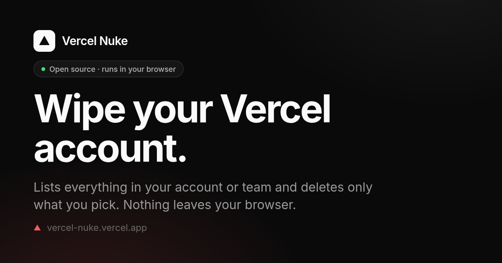
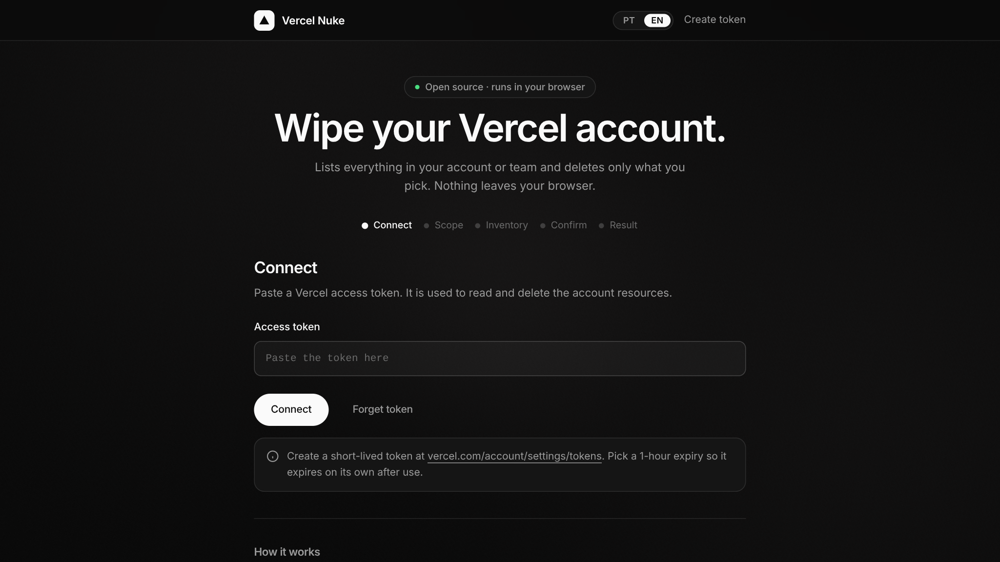
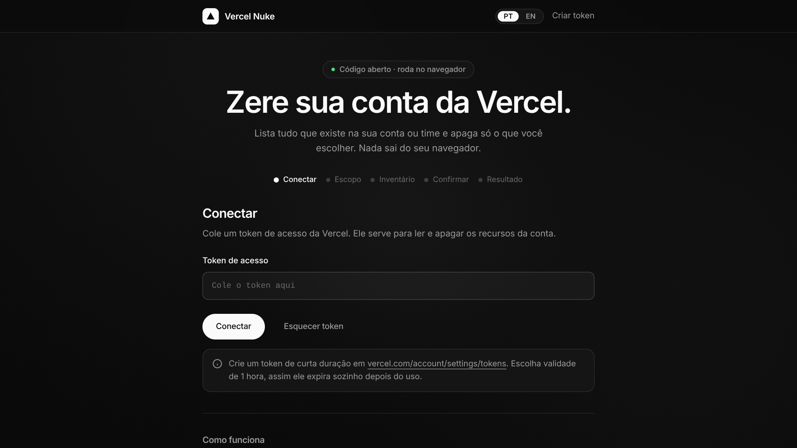
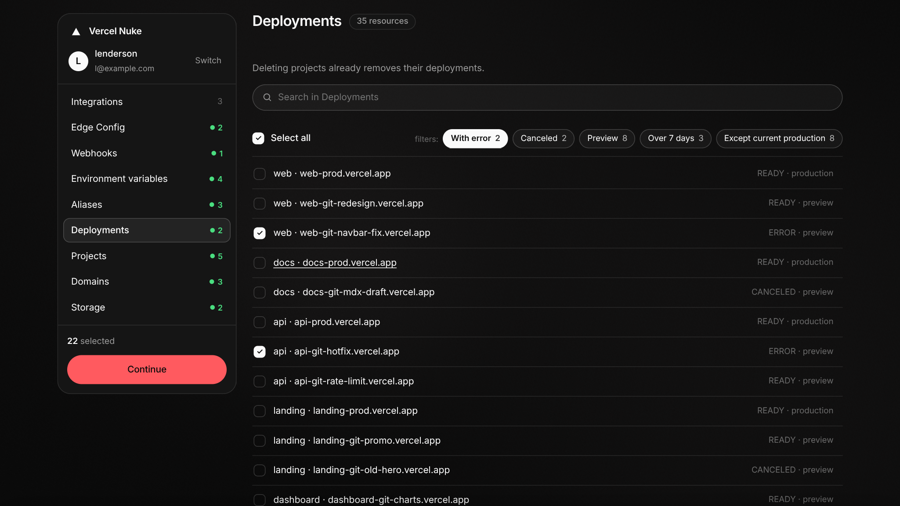
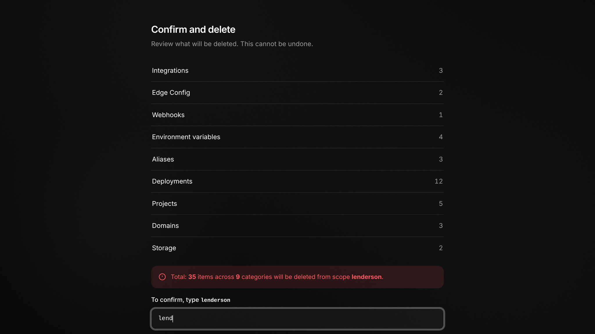
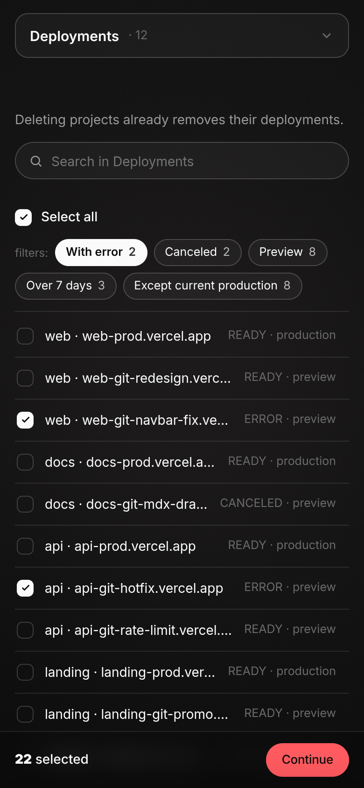

# Vercel Nuke

[English](README.md) · [Português](README.pt-BR.md)

[](LICENSE)
[](https://vercel-nuke.lenderson.com.br)
[](#security-and-privacy)
[](https://vercel-nuke.lenderson.com.br)
[](#)
[](index.html)
[](https://github.com/lenderson00/vercel-nuke/stargazers)

Wipe a Vercel account or team from your browser. It lists everything you have and deletes only what you pick.



## Live demo

https://vercel-nuke.lenderson.com.br

Bring your own Vercel token. Nothing is stored on any server.

## Gallery

| | |
| --- | --- |
|  |  |
|  |  |
|  |  |

## Features

- Deletes the things that pile up in a Vercel account: projects, deployments, domains, aliases, environment variables, webhooks, Edge Config stores, integrations, and Blob stores.
- Works on your personal account or any team you belong to. Pick the scope before anything is listed.
- Smart filters per category, for example canceled or errored deployments, deployments over 7 or 30 days old, everything except the current production, unverified domains, and preview aliases.
- Progressive loading. Each category streams in as it is listed, so you see results while the scan is still running.
- Details drawer. Click any item to see its slug, id, dates, and other metadata before you decide.
- Type to confirm. You retype the account or team name before the delete runs, so it never fires by accident.
- Rate limit aware. A 429 is retried up to five times, honoring the `Retry-After` header.
- Safe deletion order. Dependent resources go first and risky categories start unchecked (see Caveats).

## Security and privacy

- No backend. The page is a single static HTML file. There is no server collecting anything.
- Your token lives only in `localStorage`, in your browser. The "Forget token" button removes it.
- Requests go straight from your browser to `https://api.vercel.com`. Nothing passes through a middleman.
- A strict Content Security Policy locks `connect-src` down to `https://api.vercel.com` only, so the page cannot talk to any other host.
- Use a short lived token. Create a 1 hour token so it expires on its own after you are done.

## How to use

1. Create a Vercel access token at https://vercel.com/account/settings/tokens and give it a 1 hour expiry.
2. Open the app and paste the token to connect.
3. Pick the scope: your personal account or a specific team.
4. Review the inventory. Filter and select exactly what you want gone.
5. Retype the account or team name to confirm, then delete.

When you finish, delete the token in your Vercel settings or hit "Forget token".

## Caveats

- Deleting an integration (for example Neon) can also delete the database attached to it. Integrations start unchecked for that reason.
- Among storage products, only Blob stores can be deleted through the API. Other stores are left alone.
- Deleting a project already removes its deployments, so you rarely need to select deployments on their own.
- This is irreversible. There is no undo on the Vercel side once a resource is deleted.

## Run locally

It is a single file, so you can just open it:

```bash
open index.html
```

Or serve it over http if you prefer:

```bash
npx serve .
```

## Tests

Headless browser tests run against the real HTML with a mock Vercel API.

```bash
cd test
npm install
npm test
```

## Self-host on Vercel

[](https://vercel.com/new/clone?repository-url=https://github.com/lenderson00/vercel-nuke)

The repo ships `vercel.json` with the security headers and CSP already set, so a clone deploys with the same hardening as the live site.

## API endpoints

Every call goes to `https://api.vercel.com`. These are the endpoints the app touches:

| Category | Method | Endpoint |
| --- | --- | --- |
| Account | GET | `/v2/user`, `/v2/teams` |
| Projects | GET, DELETE | `/v10/projects`, `/v9/projects/{id}` |
| Deployments | GET, DELETE | `/v6/deployments`, `/v13/deployments/{id}` |
| Domains | GET, DELETE | `/v5/domains`, `/v6/domains/{name}` |
| Aliases | GET, DELETE | `/v4/aliases`, `/v2/aliases/{id}` |
| Environment variables | GET, DELETE | `/v9/projects/{id}/env`, `/v1/env` |
| Webhooks | GET, DELETE | `/v1/webhooks`, `/v1/webhooks/{id}` |
| Edge Config | GET, DELETE | `/v1/edge-config`, `/v1/edge-config/{id}` |
| Integrations | GET, DELETE | `/v1/integrations/configurations`, `/v1/integrations/configuration/{id}` |
| Storage (Blob) | GET, DELETE | `/v1/storage/stores` |

Deletion runs in category order: integrations, Edge Config, webhooks, environment variables, aliases, deployments, projects, domains, storage.

## License

MIT. See [LICENSE](LICENSE).

## Disclaimer

Not affiliated with Vercel. It uses the public Vercel API with a token you provide. You are responsible for what you delete.
